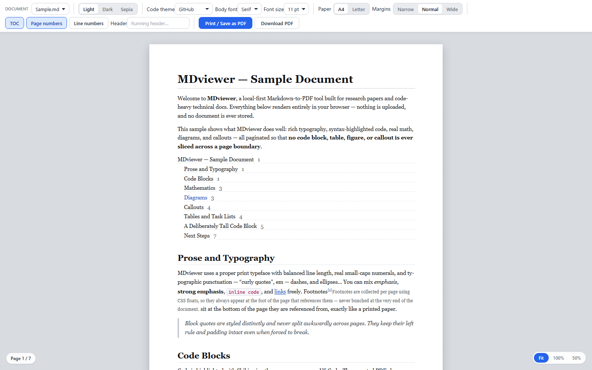
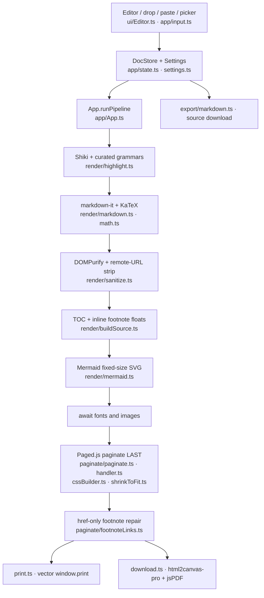

# MDviewer

<p align="center"></p>

A local Markdown reader and Markdown → PDF tool whose one hard rule is that no code block, figure, table, or callout is ever sliced across a page.

[](https://github.com/Chris0Jeky/MDviewer/actions/workflows/ci.yml)
[](LICENSE)
[](package.json)
[](package.json)

**Live app:** https://mdviewer-c9r.pages.dev/

**Windows desktop preview:** a separate reading window with Explorer file opening,
multiple documents, themes and an optional editing/PDF workspace. The editor and
pagination load only when requested. [Download/build instructions and current limits](docs/WINDOWS_DESKTOP.md).

- [What it is](#what-it-is)
- [Why it exists](#why-it-exists)
- [Privacy and usage data](#privacy-and-usage-data)
- [Features](#features)
- [Architecture](#architecture)
- [Quick start](#quick-start)
- [How export works](#how-export-works)
- [Tech stack](#tech-stack)
- [Status and roadmap](#status-and-roadmap)
- [Security](#security)
- [For contributors and agents](#for-contributors-and-agents)
- [License](#license)
- [Links](#links)



## What it is

MDviewer is a **local-first Markdown editor and paginated PDF preview**. Write in the source pane, drop a `.md` / `.markdown` file, paste Markdown, or use the file picker. The preview is the real page geometry — A4 or US Letter, with the breaks you will get in the PDF.

The web app runs entirely in the browser; the experimental Windows distribution uses a local WebView2 window. Document text, file names, headings, URLs and exports never leave the device. The only thing the app persists is a small settings object in `localStorage` (`mdviewer.settings.v1`). There is no conversion API, no automatic document storage, and no account.

The public site also sends pseudonymous, content-free usage data to the owner's first-party Pulseboard collector — never document text, file names or exports. See [Privacy and usage data](#privacy-and-usage-data) for exactly what, and how to turn it off.

Same-origin application assets (Paged.js, Mermaid, extra Shiki grammars, KaTeX fonts) may load lazily as features run. The production build is an installable PWA and works offline once those assets are cached.

## Why it exists

Typical Markdown-to-PDF converters render HTML and let the print engine break pages wherever it likes. A listing gets cut in half. A table header is stranded. A diagram is sliced down the middle. Fine for a grocery list. Not fine for a paper or a code-heavy design note.

MDviewer is built around the opposite contract: **atomic blocks stay whole**. When a block is genuinely taller than one page, it degrades on purpose — repeated table headers, continuous frames, a tight shrink-to-fit (≤ 1.15× page height), then a clean forced split — instead of being chopped. That tiered rule is specified in [`docs/design/IMPLEMENTATION_SPEC.md`](docs/design/IMPLEMENTATION_SPEC.md) §4 and asserted in [`tests/e2e/nocutoff.spec.ts`](tests/e2e/nocutoff.spec.ts).

The full rationale is in [`docs/PRODUCT_VISION.md`](docs/PRODUCT_VISION.md).

## Privacy and usage data

Your documents stay private. Markdown text, file names, titles, headings, links or URLs that appear
in a document, and PDF or print contents **never leave your browser** — not to Pulseboard, not to
anyone. This is enforced in code: every usage call goes through one module
([`src/app/pulse.ts`](src/app/pulse.ts)) whose functions accept only fixed choices, and
[`tests/pulse.test.ts`](tests/pulse.test.ts) opens documents full of marker text and fails if any of
it reaches a usage call.

**What is sent.** The live site (https://mdviewer-c9r.pages.dev only; local runs, previews and
self-hosted copies send nothing) loads the Pulseboard SDK 3.3.1 from its own origin
(`/pulseboard.js`) and sends data only to `https://pulseboard-observatory.commit-atlas.workers.dev`,
the owner's first-party collector. A one-line **Beta** bar at the top of the page explains it and
offers **Choose** and **OK**. There are three categories:

| Category | What MDviewer sends | Default outside the EEA | Default in the EEA (or unknown) |
| --- | --- | --- | --- |
| **Usage counts** | Daily aggregate counts: page views and the two export events (print dialog requested, PDF download completed), with device class (mobile/tablet/desktop), referral category and the referring platform from a fixed allowlist such as google.com or github.com (any other site is sent as `other`; never a path), whether a `utm_campaign` tag was present (MDviewer registers no campaign tags, so only `none` or `other` is sent, never the tag itself), light/dark preference and new/returning visit | On | On |
| **Diagnostics** | Page-load timings (web vitals) and engagement (visible seconds, deepest scroll % of the preview pane). MDviewer deliberately sends **no JavaScript error reports**, because an error message can quote document text | On | Off until you click OK |
| **Journeys and product data** | A random per-tab session id and these events only: `doc.opened` with `source` (`file`, `paste`, `sample`, `typed`) and `sizeBucket` (`<1k`, `1-10k`, `10-100k`, `>100k` characters); `view.mode` (`editor`, `split`, `preview`); `theme.changed` (`light`, `dark`, `sepia`); `export.print_requested` (a dialog request, never a claim a PDF was saved); `export.pdf_completed` with the page count; page views for the `home` and `editor` screens | On | Off until you click OK |

**Never sent:** document text, file names, titles, headings, URLs from documents, export contents,
your IP address (the collector sees it in transit and stores none), user agent (the browser
attaches it to every request and the collector stores none — the SDK never reads it), the page
URL or path, cookies, or any identifier other than the per-tab session id.

**Kept:** detailed data (diagnostics and journeys) for 90 days; aggregate counts currently for 14
days (planned to move to 400 days).

**How to turn it off.** Any of these works, and each is respected immediately:

- Click **Choose → Turn all off** in the Beta bar, or the small **Beta** button beside "Local session" in the toolbar once
  a choice is recorded. Turning a category off deletes its local keys and drops anything queued.
- Turn on **Global Privacy Control** or **Do Not Track** in your browser: every category is off,
  no bar is shown and no request of any kind is made.
- Block `/pulseboard.js` or the collector with a content blocker, or run MDviewer locally
  (`npm start`) — MDviewer works exactly the same without it.

**On your device** the SDK stores your choice (`pulseboard:consent:v3:mdviewer`), a visit marker
(`pulseboard:visit:mdviewer`: in `localStorage` only the month of your last visit, and in
`sessionStorage` a copy of this tab's answer, `new` or `returning`, gone when the tab closes; neither
is written in the EEA until you click OK), a region hint (`pulseboard:region:mdviewer` in `sessionStorage`, just `eea` or `other`, gone when
the tab closes), and the per-tab session record in `sessionStorage`. Details of the SDK and collector:
[Pulseboard `observatory/docs/SDK.md`](https://github.com/Chris0Jeky/Pulseboard/blob/main/observatory/docs/SDK.md).

## Features

Only what the code actually does:

- **No-slice pagination.** Code blocks, figures, tables and callouts stay on one page when they fit. Oversize blocks shrink slightly (≤ 1.15×) or split cleanly; tables repeat their header. List items fragment like paragraphs so a long checklist does not leave half-blank sheets.
- **Live split workspace.** Markdown / Split / Preview. A syntax-coloured source pane (`textarea` over a Shiki backdrop) beside the paginated pages. The divider is draggable and keyboard-operable; the ratio persists. Switching views does not re-render or re-paginate. The editing surface is stripped out of the printed PDF.
- **Two PDF paths from one layout.** [Print / Save as PDF](#how-export-works) is the vector path. Download PDF is the raster fallback. Both consume the same already-broken page DOM. The PDF is always dark-on-white, whatever screen theme you are using.
- **Syntax-highlighted code** via [Shiki](https://shiki.style/) — TextMate grammars, six theme families (GitHub, VS Code, Nord, Min, One, Catppuccin), each a light/dark pair. Print forces the light side. Optional CSS line numbers. Unknown fence languages fall back to plain text and surface a warning.
- **Math** via [KaTeX](https://katex.org/) (inline and display). Bad TeX renders as a red inline error instead of aborting the document.
- **Diagrams** via [Mermaid](https://mermaid.js.org/) — rendered to a fixed-size SVG *before* pagination measures heights, then sanitized again. Print stays on the light diagram theme.
- **Callouts** — `:::note`, `:::tip`, `:::warning`, `:::danger`.
- **Footnotes** collected at the foot of the page that cites them (Paged.js `float: footnote`), with citation hrefs repaired after preview.
- **Table of contents** with real `target-counter` page numbers. An author-placed `[[toc]]` stays put; otherwise a TOC is synthesized after the first `h1`.
- **Task lists**, block quotes, and markdown-it's typographer (quotes, dashes). Pipe tables in the sample and fixtures render as real `<table>`s and are treated as atomic blocks.
- **Page furniture.** A4 or US Letter; narrow / normal / wide margins (12.7 / 20 / 30 mm); body font serif / sans / slab; 10–13 pt; optional running header, page numbers, title-page (blank header and folio on page 1), and code line numbers.
- **Screen chrome only:** light / dark / sepia. Does not recolour the page sheets or the PDF.
- **Preview zoom** — Fit / 100% / 50%. Paint-only (`transform: scale`); it never changes page breaks. A pinned page chip tracks which sheet you are on.
- **Ingestion.** Drag-and-drop, paste, file picker, or **Open Markdown** (`Ctrl/Cmd+O`). Non-Markdown files are skipped with a banner; reads that fail are reported as unreadable, not as the wrong type. Soft confirm at 250 kB; hard refuse at 25 MB.
- **Source download.** **Save Markdown** (`Ctrl/Cmd+S`) writes the exact in-memory text to a file. It does not persist the document in the app.
- **Close recovery.** Undo the latest close in this tab. Reload or closing the tab clears it. No history store.
- **Installable PWA** with a prompt-based update (never an unattended swap under a live document) and a Workbox precache of the lazy feature chunks and KaTeX fonts, so Print and math still work offline.
- **Sanitized HTML.** `markdown-it` runs with `html: true` for KaTeX/Mermaid output; every fragment is run through DOMPurify and a second pass that strips automatic remote-resource loads. Embedded raster data URLs are the only images allowed.

## Architecture

Pagination measures real, laid-out heights. Anything that still has to load — a grammar, a diagram, a font — changes those heights. So the pipeline is strict, and **pagination runs last**.



Re-pagination (paper, margins, font, TOC, headers, line numbers) re-runs the full render pipeline: Markdown, Mermaid, fonts and images, then pagination. Screen theme, zoom, view mode and split ratio are CSS-only and are not reflow keys.

Renders are **serialized**, not just debounced: two overlapping pipeline runs would share one Paged.js host and page counter. Both export paths capture the document and settings at click time and `await` a render lock, so an export mid-keystroke cannot ship the previous pages.

```
src/
  main.ts          Vite entry — boots the app, wires drag/drop/paste, PWA prompt
  app/             App controller, DocStore, settings, input, Pulseboard seam
  ui/              toolbar, source editor, splitter, canvas, empty state, banner
  render/          markdown-it + Shiki + KaTeX + Mermaid + sanitize + source builder
  paginate/        Paged.js engine, @page CSS, measure, shrink-to-fit, footnote hrefs
  export/          print (vector), download (raster), Markdown source save
  styles/          app / workspace / editor / preview / document / print / shiki / PWA
  types/           local ambient shims
tests/             Vitest unit + Playwright Chromium e2e (incl. no-cutoff)
docs/              vision, architecture, roadmap, design contract
```

Deeper map: [`docs/ARCHITECTURE.md`](docs/ARCHITECTURE.md) and [`autodoc/AGENT_INDEX.md`](autodoc/AGENT_INDEX.md).

## Quick start

Requires Node `^22.22.2 || ^24.15.0 || >=26` ([`package.json` `engines`](package.json)).

```bash
npm install      # install dependencies
npm run dev      # Vite dev server (default http://localhost:5180 — use the URL it prints)
npm run build    # typecheck + production bundle in dist/ + licence bundle
npm start        # build, then serve dist/ on 127.0.0.1:4173 and open it
```

`npm run serve` serves an already-built `dist/` (default `127.0.0.1:4173`) without rebuilding. On Windows, `Start MDviewer.cmd` is a double-click wrapper around `npm start`.

The app opens in **Split**: source on the left, paginated preview on the right. Type, or drop a `.md` / `.markdown` file. **View** switches Markdown / Split / Preview. **Document layout** holds typography, paper and page furniture. **Print / Save as PDF** is the quality path — in the browser dialog, set the destination to **Save as PDF**.

For public hosting, Tailscale, and tunnels, see [`docs/DEPLOYMENT.md`](docs/DEPLOYMENT.md). A git push does not deploy; production is a reviewed promotion of a tested `dist/`.

Useful checks (what CI runs on Node 22 and 24, plus Chromium against the production bundle):

```bash
npm run typecheck
npm run lint
npm run test          # Vitest
npm run build         # production dist/, which the preview e2e target serves
E2E_TARGET=preview npm run test:e2e  # Playwright Chromium against the production bundle, incl. tests/e2e/nocutoff.spec.ts
npm run agent:check   # typecheck + lint + unit + serve tests + observatory guard
```

## How export works

MDviewer paginates once with [Paged.js](https://pagedjs.org/) and feeds that single, already-broken page layout to **two** export paths:

1. **Print / Save as PDF (primary).** `window.print()` plus print-media CSS. Vector: selectable text, crisp code, smallest file. The breaks in the preview are the breaks in the PDF. In the browser print dialog, choose **Save as PDF**.
2. **Download PDF (fallback).** Rasterizes each already-paginated page with html2canvas-pro and assembles a PDF with jsPDF. Text is not selectable and the file is larger. Same page-break safety. Best-effort; use the print path when you can.

The exported PDF is **always dark-on-white**, regardless of the screen theme. Closing the last document tears down injected Paged.js styles so a later print cannot pick up stale sheets.

## Tech stack

Versions from [`package.json`](package.json) at this commit. CI (`.github/workflows/ci.yml`) runs the verify job on Node 22 and 24, and Playwright Chromium against `vite preview` of the production bundle.

| Layer | What |
| --- | --- |
| Language / build | TypeScript 6, Vite 8, ESLint 10, `engines.node` `^22.22.2 \|\| ^24.15.0 \|\| >=26` |
| UI | Vanilla TypeScript. No React/Vue/Svelte. Toolbar, editor, splitter and canvas are small DOM builders. |
| Markdown | markdown-it 15 + footnote, anchor, toc-done-right, container, attrs, task-lists. `html: true`, then DOMPurify. |
| Highlight / math / diagrams | Shiki 4 (fine-grained core + Oniguruma WASM; extra grammars on demand), KaTeX 0.19, Mermaid 12 |
| Pagination | Paged.js 0.4.3 — the only pagination engine |
| Export | `window.print()`; html2canvas-pro + jsPDF 4 as fallback; Blob download for source `.md` |
| Tests | Vitest 5 + jsdom; Playwright Chromium e2e, including the no-cutoff geometry check |
| PWA | `vite-plugin-pwa`, Workbox precache, prompt-based updates |
| Hosting | Static files on Cloudflare Pages. No document backend. |

## Status and roadmap

From [`docs/Project_Roadmap.md`](docs/Project_Roadmap.md) (last updated 2026-10-02) and the open GitHub issue list.

| Phase | Status | Notes |
| --- | --- | --- |
| P0 Scaffolding | Done | Repo, Vite/Vitest/Playwright, pinned design specs |
| P1 Core pipeline | Done | Render → paginate → both export paths; no-slice e2e; Gate 3 (manual Chrome PDF inspection) accepted |
| P2 UX polish | In progress | Split workspace, QA-sweep fixes, responsive toolbar, screen-theme / title-page / header work shipped. Remaining polish is tracked as issues, not a second product. |
| P3 Hardening and distribution | In progress | Sanitization, PWA/offline, large-doc budget + 250 kB confirm gate, production-egress proofs shipped. Live app is at the URL above. Automated Pages promotion is written; the first live dispatch still needs the `production` environment hardened. Canonical custom hostname is blocked until a name is owned. |
| P4 Stretch | Deferred | Extra paper sizes/orientations; custom user themes |

**Windows direction:** the standalone reading path and CI-built installer are an experimental P3 distribution. Native desktop acceptance and measured memory work are described in [the Windows guide](docs/WINDOWS_DESKTOP.md). The live [issue list](https://github.com/Chris0Jeky/MDviewer/issues) is authoritative for remaining work; the late-file focus race in #131 is already fixed.

Operator-only live-site and deploy gates (split-workspace feel, PWA update toast, Beta-bar acceptance, first automated promotion) live in [`ACTION_ITEMS.md`](ACTION_ITEMS.md). They are not product gaps in the code path above.

## Security

- **Documents do not leave the device.** No document `fetch` / XHR / WebSocket. No document persistence. The one runtime network exception is the Pulseboard SDK on the production origin, reached only through [`src/app/pulse.ts`](src/app/pulse.ts) with closed enums, size buckets and counts. [`tests/pulse.test.ts`](tests/pulse.test.ts) and [`tests/pulse-egress.test.ts`](tests/pulse-egress.test.ts) guard that seam.
- **Untrusted Markdown is sanitized** before it hits the DOM (`src/render/sanitize.ts`). Executable tags, event handlers and automatic remote resource URLs are stripped; Mermaid SVG is sanitized again. User-initiated `https:` links remain clickable.
- **Error messages are kept off telemetry.** `installErrorShield` stops `error` / `unhandledrejection` reaching the SDK so a KaTeX or Mermaid parse error cannot leak document text.
- **Production `dist/` carries the GPL text**, the exact corresponding-source link, the project notice, and installed dependency licence texts (`THIRD_PARTY_NOTICES.md`; written by `npm run build`). Preserve those files when you redistribute a build.
- There is no `SECURITY.md` in this repo. Report a document-exfiltration or XSS path to the owner rather than in a public issue.

## For contributors and agents

Start with [`ACTION_ITEMS.md`](ACTION_ITEMS.md) (human-only gates + current-state snapshot) and the resumable [`ORCHESTRATOR.md`](ORCHESTRATOR.md). Repo-wide rules: [`AGENTS.md`](AGENTS.md). Then the design contract:

- [`docs/design/IMPLEMENTATION_SPEC.md`](docs/design/IMPLEMENTATION_SPEC.md) — pinned signatures, the load-bearing render order, CSS/DOM names, no-slice tiers.
- [`docs/design/LIBRARY_NOTES.md`](docs/design/LIBRARY_NOTES.md) — version-correct integration notes for each library.
- [`docs/ARCHITECTURE.md`](docs/ARCHITECTURE.md) — pipeline, module responsibilities, CSS split.
- [`docs/Project_Roadmap.md`](docs/Project_Roadmap.md) — phase status and gates.
- [`autodoc/AGENT_INDEX.md`](autodoc/AGENT_INDEX.md) — code-seam map.

Do not reorder the render pipeline. Do not add a document network call or persist document bytes. PRs merge with a merge commit (no squash). `main` is protected: no rebase, force-push, or history rewrite.

## License

GNU General Public License version 3 only (`GPL-3.0-only`). See [`LICENSE`](LICENSE) and
[`RELICENSING.md`](RELICENSING.md). Versions published before 12 August 2026 remain available
under their existing MIT grant ([`LICENSES/MIT.txt`](LICENSES/MIT.txt)). Dependencies keep their
own licences; see [`THIRD_PARTY_NOTICES.md`](THIRD_PARTY_NOTICES.md).

## Links

- Live app: https://mdviewer-c9r.pages.dev/
- Product vision: [`docs/PRODUCT_VISION.md`](docs/PRODUCT_VISION.md)
- Architecture: [`docs/ARCHITECTURE.md`](docs/ARCHITECTURE.md)
- Implementation spec: [`docs/design/IMPLEMENTATION_SPEC.md`](docs/design/IMPLEMENTATION_SPEC.md)
- Roadmap: [`docs/Project_Roadmap.md`](docs/Project_Roadmap.md)
- Deployment: [`docs/DEPLOYMENT.md`](docs/DEPLOYMENT.md)
- Performance budget: [`docs/PERF_BUDGET.md`](docs/PERF_BUDGET.md)
- CI: [`.github/workflows/ci.yml`](.github/workflows/ci.yml)
- License: [`LICENSE`](LICENSE)
