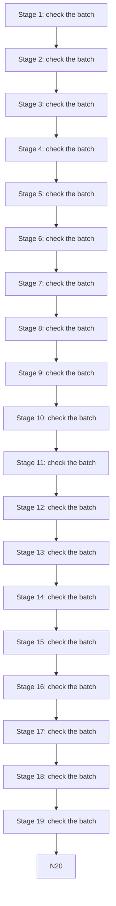

# Shrunk figure

A flowchart capped to the page height, under a heading tall enough that Tier 3 shrinks the pair onto one page (#258).

## The batch pipeline, stage by stage, from the first intake check through every review step to the final archive, with the hand-offs, the retries and the sign-off that each stage records

After the figure.
